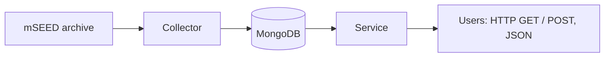

# Overview

The WFCatalog is a webservice that facilities the discovery of data through
waveform metadata. It is made up of a `collector` that is responsible for
ingestion of mSEED quality metrics to the database and the `service` that
exposes this database to users according to the specification file.

The EIDAWS WFCatalog provides access to metadata and quality parameters for
archives contributing data to EIDA. The supported request types are HTTP-GET
and HTTP-POST. Service response is in JSON. Metadata is presented with a daily
granularity. Metadata for the previous day is always available with a maximum
delay of 12 hours.

## Components

| Component | Docs | What it does | For |
| --- | --- | --- | --- |
| Collector | [collector](collector/index.md) | Python script for ingestion waveform metadata to MongoDB | Node operators |
| Service | [service](service/index.md) | Node powered implementation for the EIDA WFCatalog, exposes the database to users | End users, node operators |

Software implementation:

- Metadata extraction: ObsPy MSEEDMetadata
- Database store: MongoDB
- Service layer: NodeJS

## Source

<https://github.com/EIDA/wfcatalog>
